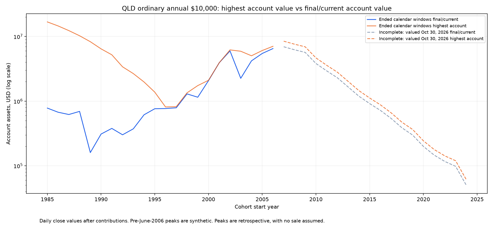

# QLD普通年度定投：40组滚动20年，最终与峰值结果

每年1月首个有行情交易日收盘投入10,000美元，全仓持有，无额外初始本金。计划起点1985—2024，共40组；完整窗口覆盖20个投入年度、本金200,000美元。数据截至2026-10-30。1985组首笔1985-01-31，单列特殊起点；1986—2006起点21组标准完整；2007—2024起点18组未完成。2007组已投20笔，但尚未到2027年计划结束日。

投入年份1985—2004的期末为2004年最后交易日。XIRR按实际现金流日期计算；峰值资产、利润及收益率均使用峰值当天本金，峰值仅为事后记录。表中金额单位均为**万美元**。

## 21组标准完整20年汇总

| 期末资产中位数 | 最差期末资产 | 最好期末资产 | XIRR中位数 | 最差XIRR | 最好XIRR | 亏损组数 |
| --- | --- | --- | --- | --- | --- | --- |
| 76.84 | 16.02 | 650.66 | 11.61% | -2.17% | 28.21% | 1/21 |

唯一亏损完整组为1989—2008：20万美元本金，期末16.02万美元，累计亏损19.92%，XIRR−2.17%。含模拟的完整组最差净值回撤−98.85%，长期定投仍会遇到深度回撤。

## 40组最终与峰值结果

| 投入年份 | 状态 | 本金 | 期末/截止资产 | 最终利润 | 最终XIRR | 最高资产 | 最高日期 | 峰值本金 | 峰值利润 | 峰值收益率 | 峰值XIRR |
| --- | --- | --- | --- | --- | --- | --- | --- | --- | --- | --- | --- |
| 1985—2004 | 1985特殊起点：1月31日 | 20.00 | 78.07 | 58.07 | 11.74% | 1,681.80 | 2000-03-27 | 16.00 | 1,665.80 | 10411.24% | 51.85% |
| 1986—2005 | 完整20年 | 20.00 | 67.39 | 47.39 | 10.55% | 1,457.51 | 2000-03-27 | 15.00 | 1,442.51 | 9616.70% | 55.12% |
| 1987—2006 | 完整20年 | 20.00 | 62.12 | 42.12 | 9.89% | 1,233.91 | 2000-03-27 | 14.00 | 1,219.91 | 8713.64% | 58.85% |
| 1988—2007 | 完整20年 | 20.00 | 69.42 | 49.42 | 10.79% | 1,026.94 | 2000-03-27 | 13.00 | 1,013.94 | 7799.53% | 63.11% |
| 1989—2008 | 完整20年 | 20.00 | 16.02 | -3.98 | -2.17% | 831.02 | 2000-03-27 | 12.00 | 819.02 | 6825.20% | 67.84% |
| 1990—2009 | 完整20年 | 20.00 | 30.95 | 10.95 | 3.99% | 644.10 | 2000-03-27 | 11.00 | 633.10 | 5755.44% | 72.93% |
| 1991—2010 | 完整20年 | 20.00 | 37.85 | 17.85 | 5.75% | 521.49 | 2000-03-27 | 10.00 | 511.49 | 5114.86% | 80.44% |
| 1992—2011 | 完整20年 | 20.00 | 30.17 | 10.17 | 3.77% | 339.69 | 2000-03-27 | 9.00 | 330.69 | 3674.36% | 84.70% |
| 1993—2012 | 完整20年 | 20.00 | 37.28 | 17.28 | 5.61% | 267.00 | 2000-03-27 | 8.00 | 259.00 | 3237.54% | 96.37% |
| 1994—2013 | 完整20年 | 20.00 | 61.51 | 41.51 | 9.80% | 197.85 | 2000-03-27 | 7.00 | 190.85 | 2726.44% | 110.86% |
| 1995—2014 | 完整20年 | 20.00 | 76.33 | 56.33 | 11.55% | 137.70 | 2000-03-27 | 6.00 | 131.70 | 2194.93% | 130.12% |
| 1996—2015 | 完整20年 | 20.00 | 76.84 | 56.84 | 11.61% | 81.29 | 2015-11-04 | 20.00 | 61.29 | 306.45% | 12.20% |
| 1997—2016 | 完整20年 | 20.00 | 78.93 | 58.93 | 11.82% | 82.11 | 2016-12-27 | 20.00 | 62.11 | 310.53% | 12.15% |
| 1998—2017 | 完整20年 | 20.00 | 129.46 | 109.46 | 15.74% | 134.42 | 2017-12-18 | 20.00 | 114.42 | 572.10% | 16.07% |
| 1999—2018 | 完整20年 | 20.00 | 115.02 | 95.02 | 14.81% | 173.99 | 2018-08-29 | 20.00 | 153.99 | 769.96% | 18.49% |
| 2000—2019 | 完整20年 | 20.00 | 207.89 | 187.89 | 19.42% | 210.33 | 2019-12-26 | 20.00 | 190.33 | 951.65% | 19.53% |
| 2001—2020 | 完整20年 | 20.00 | 392.98 | 372.98 | 24.32% | 392.98 | 2020-12-31 | 20.00 | 372.98 | 1864.89% | 24.32% |
| 2002—2021 | 完整20年 | 20.00 | 598.09 | 578.09 | 27.56% | 620.67 | 2021-11-19 | 20.00 | 600.67 | 3003.34% | 28.06% |
| 2003—2022 | 完整20年 | 20.00 | 225.48 | 205.48 | 20.05% | 591.70 | 2021-11-19 | 19.00 | 572.70 | 3014.19% | 29.73% |
| 2004—2023 | 完整20年 | 20.00 | 420.10 | 400.10 | 24.85% | 503.53 | 2021-11-19 | 18.00 | 485.53 | 2697.40% | 30.63% |
| 2005—2024 | 完整20年 | 20.00 | 546.40 | 526.40 | 26.86% | 606.70 | 2024-12-16 | 20.00 | 586.70 | 2933.50% | 27.75% |
| 2006—2025 | 完整20年 | 20.00 | 650.66 | 630.66 | 28.21% | 705.65 | 2025-10-29 | 20.00 | 685.65 | 3428.24% | 29.18% |
| 2007—2026 | 未满20年 | 20.00 | 694.06 | 674.06 | 29.04% | 846.84 | 2026-10-06 | 20.00 | 826.84 | 4134.18% | 30.74% |
| 2008—2027 | 未满20年 | 19.00 | 623.88 | 604.88 | 30.29% | 761.22 | 2026-10-06 | 19.00 | 742.22 | 3906.40% | 32.10% |
| 2009—2028 | 未满20年 | 18.00 | 567.53 | 549.53 | 31.82% | 692.45 | 2026-10-06 | 18.00 | 674.45 | 3746.95% | 33.77% |
| 2010—2029 | 未满20年 | 17.00 | 382.60 | 365.60 | 30.73% | 466.82 | 2026-10-06 | 17.00 | 449.82 | 2645.98% | 32.80% |
| 2011—2030 | 未满20年 | 16.00 | 293.99 | 277.99 | 30.80% | 358.71 | 2026-10-06 | 16.00 | 342.71 | 2141.93% | 33.03% |
| 2012—2031 | 未满20年 | 15.00 | 229.52 | 214.52 | 31.08% | 280.05 | 2026-10-06 | 15.00 | 265.05 | 1766.98% | 33.49% |
| 2013—2032 | 未满20年 | 14.00 | 165.44 | 151.44 | 30.47% | 201.85 | 2026-10-06 | 14.00 | 187.85 | 1341.80% | 33.08% |
| 2014—2033 | 未满20年 | 13.00 | 119.14 | 106.14 | 29.76% | 145.36 | 2026-10-06 | 13.00 | 132.36 | 1018.18% | 32.61% |
| 2015—2034 | 未满20年 | 12.00 | 91.65 | 79.65 | 29.89% | 111.83 | 2026-10-06 | 12.00 | 99.83 | 831.88% | 33.02% |
| 2016—2035 | 未满20年 | 11.00 | 71.90 | 60.90 | 30.41% | 87.73 | 2026-10-06 | 11.00 | 76.73 | 697.51% | 33.90% |
| 2017—2036 | 未满20年 | 10.00 | 54.01 | 44.01 | 30.35% | 65.90 | 2026-10-06 | 10.00 | 55.90 | 558.99% | 34.27% |
| 2018—2037 | 未满20年 | 9.00 | 38.70 | 29.70 | 29.44% | 47.21 | 2026-10-06 | 9.00 | 38.21 | 424.59% | 33.86% |
| 2019—2038 | 未满20年 | 8.00 | 29.86 | 21.86 | 30.17% | 36.43 | 2026-10-06 | 8.00 | 28.43 | 355.34% | 35.27% |
| 2020—2039 | 未满20年 | 7.00 | 19.95 | 12.95 | 27.58% | 24.35 | 2026-10-06 | 7.00 | 17.35 | 247.81% | 33.46% |
| 2021—2040 | 未满20年 | 6.00 | 14.64 | 8.64 | 27.49% | 17.86 | 2026-10-06 | 6.00 | 11.86 | 197.68% | 34.51% |
| 2022—2041 | 未满20年 | 5.00 | 11.65 | 6.65 | 31.43% | 14.21 | 2026-10-06 | 5.00 | 9.21 | 184.24% | 40.23% |
| 2023—2042 | 未满20年 | 4.00 | 9.81 | 5.81 | 42.30% | 11.97 | 2026-10-06 | 4.00 | 7.97 | 199.15% | 54.36% |
| 2024—2043 | 未满20年 | 3.00 | 4.98 | 1.98 | 30.32% | 6.08 | 2026-10-06 | 3.00 | 3.08 | 102.53% | 45.45% |

## 模型与核验

QLD实际行情从2006-06-21起，此前为每日2倍模拟，扣前一已知IRX利率的1倍融资成本及假设1%年费。QQQ成立前使用NDX价格回报，缺少该阶段指数股息；其后用QQQ调整收盘价；QLD成立后用实际调整收盘价，计入分配再投资与内部费用。当前没有全程实际QLD的完整20年窗口，所有已结束组均含模拟。来源为纳斯达克官方NDX历史及Yahoo Finance NDX、IRX、QQQ、QLD行情。

此前已核对完整组20笔年度投入、20万美元本金，并按买入批次独立估值、检验XIRR终值方程；峰值记录已做独立逐日估值与本金检查。最高资产对应的收益率不一定是最高累计收益率，后者单独保存在完整CSV。允许碎股，未计个人税费及交易费用；滚动窗口重叠，历史盈利比例不能当作未来概率。

[40组最终、峰值及最高收益率完整CSV](../qld_20year_1985/40组_最终与最高资产收益.csv) · [独立核验](../qld_20year_1985/independent_audit.json)

