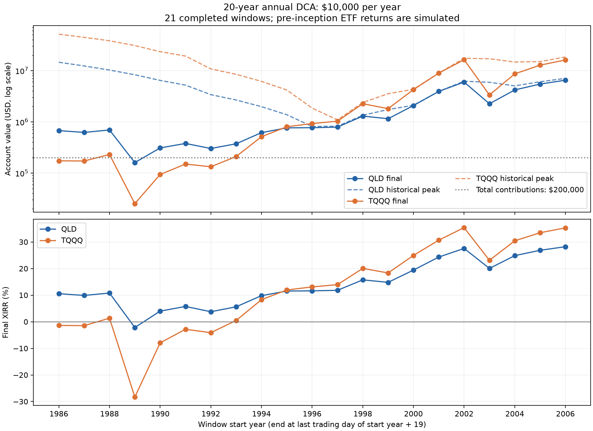

# QLD与TQQQ普通年度定投：40组滚动20年，最终与峰值结果

每年1月首个有行情交易日收盘投入10,000美元，全仓持有各自基金，无额外初始本金。QLD与TQQQ使用相同投入日期、起点和截止日期，分别独立回测。计划起点1985—2024，各40组；完整窗口覆盖20个投入年度、本金200,000美元。数据截至2026-10-30。1985组首笔1985-01-31，单列特殊起点；1986—2006起点21组标准完整；2007—2024起点18组未完成。2007组已投20笔，但尚未到2027年计划结束日。

投入年份1985—2004的期末为2004年最后交易日。XIRR按实际现金流日期计算；峰值资产、利润及收益率均使用峰值当天本金，峰值仅为事后记录，没有假设在峰值卖出。表中金额单位均为**万美元**。

## 21组标准完整20年汇总

| 基金 | 期末资产中位数 | 最差期末资产 | 最好期末资产 | XIRR中位数 | 最差XIRR | 最好XIRR | 亏损组数 | 最差净值回撤 |
| --- | --- | --- | --- | --- | --- | --- | --- | --- |
| QLD | 76.84 | 16.02 | 650.66 | 11.61% | -2.17% | 28.21% | 1/21 | -98.85% |
| TQQQ | 92.54 | 2.53 | 1,633.83 | 13.09% | -28.31% | 35.37% | 6/21 | -99.98% |

TQQQ的中位数收益更高，但亏损组数和最差亏损明显更大。最差完整窗口同为1989—2008：QLD期末16.02万美元、XIRR−2.17%；TQQQ期末2.53万美元、XIRR−28.31%，相对20万美元本金亏损87.34%。1985特殊起点未计入上述21组统计，TQQQ该组也略有亏损。

## QLD：40组最终与峰值结果

| 投入年份 | 状态 | 本金 | 期末/截止资产 | 最终利润 | 最终XIRR | 最大净值回撤 | 最高资产 | 最高日期 | 峰值本金 | 峰值利润 | 峰值收益率 | 峰值XIRR |
| --- | --- | --- | --- | --- | --- | --- | --- | --- | --- | --- | --- | --- |
| 1985—2004 | 1985特殊起点：1月31日 | 20.00 | 78.07 | 58.07 | 11.74% | -98.71% | 1,681.80 | 2000-03-27 | 16.00 | 1,665.80 | 10411.24% | 51.85% |
| 1986—2005 | 完整20年 | 20.00 | 67.39 | 47.39 | 10.55% | -98.71% | 1,457.51 | 2000-03-27 | 15.00 | 1,442.51 | 9616.70% | 55.12% |
| 1987—2006 | 完整20年 | 20.00 | 62.12 | 42.12 | 9.89% | -98.71% | 1,233.91 | 2000-03-27 | 14.00 | 1,219.91 | 8713.64% | 58.85% |
| 1988—2007 | 完整20年 | 20.00 | 69.42 | 49.42 | 10.79% | -98.71% | 1,026.94 | 2000-03-27 | 13.00 | 1,013.94 | 7799.53% | 63.11% |
| 1989—2008 | 完整20年 | 20.00 | 16.02 | -3.98 | -2.17% | -98.79% | 831.02 | 2000-03-27 | 12.00 | 819.02 | 6825.20% | 67.84% |
| 1990—2009 | 完整20年 | 20.00 | 30.95 | 10.95 | 3.99% | -98.85% | 644.10 | 2000-03-27 | 11.00 | 633.10 | 5755.44% | 72.93% |
| 1991—2010 | 完整20年 | 20.00 | 37.85 | 17.85 | 5.75% | -98.85% | 521.49 | 2000-03-27 | 10.00 | 511.49 | 5114.86% | 80.44% |
| 1992—2011 | 完整20年 | 20.00 | 30.17 | 10.17 | 3.77% | -98.85% | 339.69 | 2000-03-27 | 9.00 | 330.69 | 3674.36% | 84.70% |
| 1993—2012 | 完整20年 | 20.00 | 37.28 | 17.28 | 5.61% | -98.85% | 267.00 | 2000-03-27 | 8.00 | 259.00 | 3237.54% | 96.37% |
| 1994—2013 | 完整20年 | 20.00 | 61.51 | 41.51 | 9.80% | -98.85% | 197.85 | 2000-03-27 | 7.00 | 190.85 | 2726.44% | 110.86% |
| 1995—2014 | 完整20年 | 20.00 | 76.33 | 56.33 | 11.55% | -98.85% | 137.70 | 2000-03-27 | 6.00 | 131.70 | 2194.93% | 130.12% |
| 1996—2015 | 完整20年 | 20.00 | 76.84 | 56.84 | 11.61% | -98.85% | 81.29 | 2015-11-04 | 20.00 | 61.29 | 306.45% | 12.20% |
| 1997—2016 | 完整20年 | 20.00 | 78.93 | 58.93 | 11.82% | -98.85% | 82.11 | 2016-12-27 | 20.00 | 62.11 | 310.53% | 12.15% |
| 1998—2017 | 完整20年 | 20.00 | 129.46 | 109.46 | 15.74% | -98.85% | 134.42 | 2017-12-18 | 20.00 | 114.42 | 572.10% | 16.07% |
| 1999—2018 | 完整20年 | 20.00 | 115.02 | 95.02 | 14.81% | -98.85% | 173.99 | 2018-08-29 | 20.00 | 153.99 | 769.96% | 18.49% |
| 2000—2019 | 完整20年 | 20.00 | 207.89 | 187.89 | 19.42% | -98.85% | 210.33 | 2019-12-26 | 20.00 | 190.33 | 951.65% | 19.53% |
| 2001—2020 | 完整20年 | 20.00 | 392.98 | 372.98 | 24.32% | -95.02% | 392.98 | 2020-12-31 | 20.00 | 372.98 | 1864.89% | 24.32% |
| 2002—2021 | 完整20年 | 20.00 | 598.09 | 578.09 | 27.56% | -83.13% | 620.67 | 2021-11-19 | 20.00 | 600.67 | 3003.34% | 28.06% |
| 2003—2022 | 完整20年 | 20.00 | 225.48 | 205.48 | 20.05% | -83.13% | 591.70 | 2021-11-19 | 19.00 | 572.70 | 3014.19% | 29.73% |
| 2004—2023 | 完整20年 | 20.00 | 420.10 | 400.10 | 24.85% | -83.13% | 503.53 | 2021-11-19 | 18.00 | 485.53 | 2697.40% | 30.63% |
| 2005—2024 | 完整20年 | 20.00 | 546.40 | 526.40 | 26.86% | -83.13% | 606.70 | 2024-12-16 | 20.00 | 586.70 | 2933.50% | 27.75% |
| 2006—2025 | 完整20年 | 20.00 | 650.66 | 630.66 | 28.21% | -83.13% | 705.65 | 2025-10-29 | 20.00 | 685.65 | 3428.24% | 29.18% |
| 2007—2026 | 未满20年 | 20.00 | 694.06 | 674.06 | 29.04% | -83.13% | 846.84 | 2026-10-06 | 20.00 | 826.84 | 4134.18% | 30.74% |
| 2008—2027 | 未满20年 | 19.00 | 623.88 | 604.88 | 30.29% | -79.70% | 761.22 | 2026-10-06 | 19.00 | 742.22 | 3906.40% | 32.10% |
| 2009—2028 | 未满20年 | 18.00 | 567.53 | 549.53 | 31.82% | -63.68% | 692.45 | 2026-10-06 | 18.00 | 674.45 | 3746.95% | 33.77% |
| 2010—2029 | 未满20年 | 17.00 | 382.60 | 365.60 | 30.73% | -63.68% | 466.82 | 2026-10-06 | 17.00 | 449.82 | 2645.98% | 32.80% |
| 2011—2030 | 未满20年 | 16.00 | 293.99 | 277.99 | 30.80% | -63.68% | 358.71 | 2026-10-06 | 16.00 | 342.71 | 2141.93% | 33.03% |
| 2012—2031 | 未满20年 | 15.00 | 229.52 | 214.52 | 31.08% | -63.68% | 280.05 | 2026-10-06 | 15.00 | 265.05 | 1766.98% | 33.49% |
| 2013—2032 | 未满20年 | 14.00 | 165.44 | 151.44 | 30.47% | -63.68% | 201.85 | 2026-10-06 | 14.00 | 187.85 | 1341.80% | 33.08% |
| 2014—2033 | 未满20年 | 13.00 | 119.14 | 106.14 | 29.76% | -63.68% | 145.36 | 2026-10-06 | 13.00 | 132.36 | 1018.18% | 32.61% |
| 2015—2034 | 未满20年 | 12.00 | 91.65 | 79.65 | 29.89% | -63.68% | 111.83 | 2026-10-06 | 12.00 | 99.83 | 831.88% | 33.02% |
| 2016—2035 | 未满20年 | 11.00 | 71.90 | 60.90 | 30.41% | -63.68% | 87.73 | 2026-10-06 | 11.00 | 76.73 | 697.51% | 33.90% |
| 2017—2036 | 未满20年 | 10.00 | 54.01 | 44.01 | 30.35% | -63.68% | 65.90 | 2026-10-06 | 10.00 | 55.90 | 558.99% | 34.27% |
| 2018—2037 | 未满20年 | 9.00 | 38.70 | 29.70 | 29.44% | -63.68% | 47.21 | 2026-10-06 | 9.00 | 38.21 | 424.59% | 33.86% |
| 2019—2038 | 未满20年 | 8.00 | 29.86 | 21.86 | 30.17% | -63.68% | 36.43 | 2026-10-06 | 8.00 | 28.43 | 355.34% | 35.27% |
| 2020—2039 | 未满20年 | 7.00 | 19.95 | 12.95 | 27.58% | -63.68% | 24.35 | 2026-10-06 | 7.00 | 17.35 | 247.81% | 33.46% |
| 2021—2040 | 未满20年 | 6.00 | 14.64 | 8.64 | 27.49% | -63.68% | 17.86 | 2026-10-06 | 6.00 | 11.86 | 197.68% | 34.51% |
| 2022—2041 | 未满20年 | 5.00 | 11.65 | 6.65 | 31.43% | -63.08% | 14.21 | 2026-10-06 | 5.00 | 9.21 | 184.24% | 40.23% |
| 2023—2042 | 未满20年 | 4.00 | 9.81 | 5.81 | 42.30% | -42.29% | 11.97 | 2026-10-06 | 4.00 | 7.97 | 199.15% | 54.36% |
| 2024—2043 | 未满20年 | 3.00 | 4.98 | 1.98 | 30.32% | -42.29% | 6.08 | 2026-10-06 | 3.00 | 3.08 | 102.53% | 45.45% |

## TQQQ：40组最终与峰值结果

| 投入年份 | 状态 | 本金 | 期末/截止资产 | 最终利润 | 最终XIRR | 最大净值回撤 | 最高资产 | 最高日期 | 峰值本金 | 峰值利润 | 峰值收益率 | 峰值XIRR |
| --- | --- | --- | --- | --- | --- | --- | --- | --- | --- | --- | --- | --- |
| 1985—2004 | 1985特殊起点：1月31日 | 20.00 | 19.36 | -0.64 | -0.31% | -99.95% | 5,786.75 | 2000-03-27 | 16.00 | 5,770.75 | 36067.17% | 66.40% |
| 1986—2005 | 完整20年 | 20.00 | 17.34 | -2.66 | -1.38% | -99.95% | 5,144.77 | 2000-03-27 | 15.00 | 5,129.77 | 34198.47% | 71.37% |
| 1987—2006 | 完整20年 | 20.00 | 17.19 | -2.81 | -1.46% | -99.95% | 4,469.72 | 2000-03-27 | 14.00 | 4,455.72 | 31826.57% | 77.21% |
| 1988—2007 | 完整20年 | 20.00 | 23.04 | 3.04 | 1.33% | -99.95% | 3,831.95 | 2000-03-27 | 13.00 | 3,818.95 | 29376.57% | 84.10% |
| 1989—2008 | 完整20年 | 20.00 | 2.53 | -17.47 | -28.31% | -99.97% | 3,089.48 | 2000-03-27 | 12.00 | 3,077.48 | 25645.69% | 91.44% |
| 1990—2009 | 完整20年 | 20.00 | 9.38 | -10.62 | -7.94% | -99.98% | 2,345.60 | 2000-03-27 | 11.00 | 2,334.60 | 21223.60% | 99.38% |
| 1991—2010 | 完整20年 | 20.00 | 14.99 | -5.01 | -2.84% | -99.98% | 1,924.53 | 2000-03-27 | 10.00 | 1,914.53 | 19145.33% | 111.60% |
| 1992—2011 | 完整20年 | 20.00 | 13.26 | -6.74 | -4.11% | -99.98% | 1,081.33 | 2000-03-27 | 9.00 | 1,072.33 | 11914.82% | 116.68% |
| 1993—2012 | 完整20年 | 20.00 | 21.04 | 1.04 | 0.48% | -99.98% | 848.62 | 2000-03-27 | 8.00 | 840.62 | 10507.71% | 135.43% |
| 1994—2013 | 完整20年 | 20.00 | 51.21 | 31.21 | 8.29% | -99.98% | 616.87 | 2000-03-27 | 7.00 | 609.87 | 8712.43% | 159.29% |
| 1995—2014 | 完整20年 | 20.00 | 80.16 | 60.16 | 11.94% | -99.98% | 418.40 | 2000-03-27 | 6.00 | 412.40 | 6873.32% | 192.66% |
| 1996—2015 | 完整20年 | 20.00 | 92.54 | 72.54 | 13.09% | -99.98% | 185.53 | 2000-03-27 | 5.00 | 180.53 | 3610.59% | 213.81% |
| 1997—2016 | 完整20年 | 20.00 | 103.06 | 83.06 | 13.94% | -99.98% | 109.21 | 2016-12-27 | 20.00 | 89.21 | 446.05% | 14.41% |
| 1998—2017 | 完整20年 | 20.00 | 225.61 | 205.61 | 20.06% | -99.98% | 238.87 | 2017-12-18 | 20.00 | 218.87 | 1094.33% | 20.54% |
| 1999—2018 | 完整20年 | 20.00 | 180.99 | 160.99 | 18.35% | -99.98% | 353.77 | 2018-08-29 | 20.00 | 333.77 | 1668.86% | 24.08% |
| 2000—2019 | 完整20年 | 20.00 | 425.08 | 405.08 | 24.93% | -99.98% | 432.55 | 2019-12-26 | 20.00 | 412.55 | 2062.73% | 25.09% |
| 2001—2020 | 完整20年 | 20.00 | 894.73 | 874.73 | 30.67% | -99.65% | 894.73 | 2020-12-31 | 20.00 | 874.73 | 4373.65% | 30.67% |
| 2002—2021 | 完整20年 | 20.00 | 1,633.83 | 1,613.83 | 35.37% | -96.54% | 1,740.02 | 2021-11-19 | 20.00 | 1,720.02 | 8600.10% | 36.15% |
| 2003—2022 | 完整20年 | 20.00 | 335.18 | 315.18 | 23.10% | -94.54% | 1,706.09 | 2021-11-19 | 19.00 | 1,687.09 | 8879.43% | 38.60% |
| 2004—2023 | 完整20年 | 20.00 | 864.98 | 844.98 | 30.43% | -94.54% | 1,471.88 | 2021-11-19 | 18.00 | 1,453.88 | 8077.12% | 40.22% |
| 2005—2024 | 完整20年 | 20.00 | 1,279.77 | 1,259.77 | 33.46% | -94.54% | 1,503.78 | 2024-12-16 | 20.00 | 1,483.78 | 7418.89% | 34.82% |
| 2006—2025 | 完整20年 | 20.00 | 1,615.66 | 1,595.66 | 35.29% | -94.54% | 1,845.23 | 2025-10-29 | 20.00 | 1,825.23 | 9126.13% | 36.76% |
| 2007—2026 | 未满20年 | 20.00 | 1,790.64 | 1,770.64 | 36.51% | -94.54% | 2,507.99 | 2026-06-02 | 20.00 | 2,487.99 | 12439.94% | 40.33% |
| 2008—2027 | 未满20年 | 19.00 | 1,664.85 | 1,645.85 | 38.54% | -92.67% | 2,331.80 | 2026-06-02 | 19.00 | 2,312.80 | 12172.62% | 42.68% |
| 2009—2028 | 未满20年 | 18.00 | 1,569.10 | 1,551.10 | 40.98% | -81.66% | 2,197.69 | 2026-06-02 | 18.00 | 2,179.69 | 12109.40% | 45.51% |
| 2010—2029 | 未满20年 | 17.00 | 881.21 | 864.21 | 38.72% | -81.66% | 1,234.24 | 2026-06-02 | 17.00 | 1,217.24 | 7160.21% | 43.46% |
| 2011—2030 | 未满20年 | 16.00 | 633.44 | 617.44 | 38.71% | -81.66% | 887.19 | 2026-06-02 | 16.00 | 871.19 | 5444.96% | 43.81% |
| 2012—2031 | 未满20年 | 15.00 | 471.05 | 456.05 | 39.08% | -81.66% | 659.75 | 2026-06-02 | 15.00 | 644.75 | 4298.34% | 44.61% |
| 2013—2032 | 未满20年 | 14.00 | 296.41 | 282.41 | 37.50% | -81.66% | 415.15 | 2026-06-02 | 14.00 | 401.15 | 2865.37% | 43.43% |
| 2014—2033 | 未满20年 | 13.00 | 185.55 | 172.55 | 35.57% | -81.66% | 259.88 | 2026-06-02 | 13.00 | 246.88 | 1899.07% | 41.97% |
| 2015—2034 | 未满20年 | 12.00 | 133.78 | 121.78 | 35.35% | -81.66% | 187.37 | 2026-06-02 | 12.00 | 175.37 | 1461.44% | 42.40% |
| 2016—2035 | 未满20年 | 11.00 | 101.33 | 90.33 | 35.91% | -81.66% | 141.92 | 2026-06-02 | 11.00 | 130.92 | 1190.20% | 43.82% |
| 2017—2036 | 未满20年 | 10.00 | 72.09 | 62.09 | 35.53% | -81.66% | 100.97 | 2026-06-02 | 10.00 | 90.97 | 909.69% | 44.42% |
| 2018—2037 | 未满20年 | 9.00 | 48.02 | 39.02 | 33.82% | -81.66% | 67.26 | 2026-06-02 | 9.00 | 58.26 | 647.36% | 43.82% |
| 2019—2038 | 未满20年 | 8.00 | 37.27 | 29.27 | 35.34% | -81.66% | 52.20 | 2026-06-02 | 8.00 | 44.20 | 552.54% | 47.12% |
| 2020—2039 | 未满20年 | 7.00 | 23.38 | 16.38 | 31.84% | -81.66% | 32.74 | 2026-06-02 | 7.00 | 25.74 | 367.78% | 45.37% |
| 2021—2040 | 未满20年 | 6.00 | 17.64 | 11.64 | 33.47% | -81.66% | 24.70 | 2026-06-02 | 6.00 | 18.70 | 311.71% | 50.20% |
| 2022—2041 | 未满20年 | 5.00 | 14.64 | 9.64 | 40.52% | -81.02% | 20.50 | 2026-06-02 | 5.00 | 15.50 | 310.01% | 63.20% |
| 2023—2042 | 未满20年 | 4.00 | 13.11 | 9.11 | 57.81% | -58.04% | 18.37 | 2026-06-02 | 4.00 | 14.37 | 359.15% | 93.74% |
| 2024—2043 | 未满20年 | 3.00 | 5.44 | 2.44 | 36.18% | -58.04% | 7.62 | 2026-06-02 | 3.00 | 4.62 | 154.04% | 78.85% |

## 模型与核验

QLD实际行情从2006-06-21起，TQQQ从2010-02-11起；此前分别模拟每日2倍、3倍收益，扣前一已知IRX国债利率的1倍、2倍融资成本及假设1%年费，按实际日历天数摊销。QQQ成立前使用NDX价格回报，缺少该阶段指数股息；其后用QQQ调整收盘价。基金成立后用各自实际调整收盘价，计入分配再投资与基金内部费用，不再额外扣费。当前两只基金都没有全程实际行情的完整20年窗口，所有已结束组均含成立前模拟。来源为纳斯达克官方NDX历史及Yahoo Finance NDX、IRX、QQQ、QLD、TQQQ行情。

QLD沿用此前已核验结果。本次TQQQ以50位Decimal独立重建每日价格，逐日按各买入批次独立估值，核对40组本金与账户资产、全部峰值日期及最高累计收益率日期；最终和峰值XIRR另用终值复利方程检查，共80项。2011年以后14组还直接用原始TQQQ调整收盘价估值，绕过模拟归一化。与此前30组10年TQQQ普通定投在相同终点的结果逐组一致。

最高资产对应的收益率不一定是最高累计收益率，后者和最终累计收益率另存完整CSV。最大净值回撤剔除外部入金影响，不是账户相对本金亏损。允许碎股，未计个人税费、佣金、点差及滑点；IRX及1%模拟年费是模型假设，滚动窗口重叠，历史盈利比例不能当作未来概率。

[80组QLD与TQQQ完整CSV](../tqqq_20year_1985/80组_QLD与TQQQ最终与峰值.csv) · [TQQQ独立核验](../tqqq_20year_1985/verification.json) · [QLD独立核验](../qld_20year_1985/independent_audit.json) · [可复现计算脚本](../tqqq_20year_1985/study.py)

