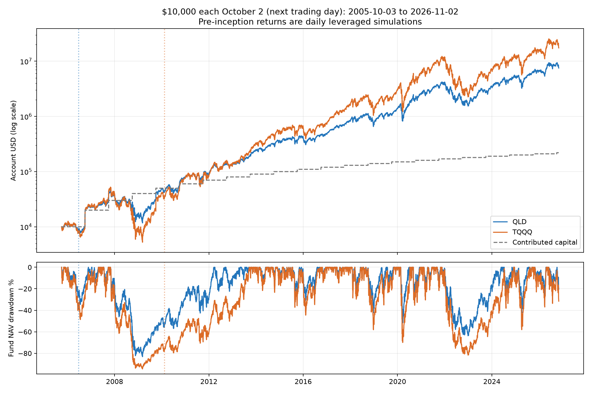

# 2005年10月2日至今：QLD与TQQQ每年定投

每年10月2日投入10,000美元，遇到非交易日顺延，收盘成交。首笔2005-10-03，截止2026-11-02，共22笔、220,000美元。不是每年1月投入，也没有额外初始本金。

| 项目 | QLD | TQQQ |
|---|---:|---:|
| 最终资产 | 7,538,662.97 | 17,450,374.74 |
| 盈利 | 7,318,662.97 | 17,230,374.74 |
| 累计收益 | 3326.66% | 7831.99% |
| XIRR年化 | 27.29% | 33.42% |
| 最高资产 | 9,460,411.12 | 25,478,592.69 |
| 最高资产日期 | 2026-10-06 | 2026-06-02 |
| 峰值本金 | 220,000 | 210,000 |
| 峰值累计收益 | 4200.19% | 12032.66% |
| 峰值XIRR | 29.08% | 37.20% |
| 净值最大回撤 | -83.13% | -94.54% |
| 回撤前高日期 | 2007-10-31 | 2007-10-31 |
| 回撤最低日期 | 2009-03-09 | 2009-03-09 |

## 模型与验证

QLD实际行情从2006-06-21开始，TQQQ从2010-02-11开始。成立前用QQQ实际复权日收益模拟每日2倍或3倍，分别扣1倍或2倍前一已知IRX利率作融资成本及假设1%年费，按日历日摊销。成立后直接采用各ETF实际复权收益，不再重复扣费或加股息。
全区间基础收益使用复权数据，包含分配再投资；允许小数份额，未扣个人税费、佣金、点差和滑点。成立前是理论代理，不能当作实际可交易的基金历史。
最大回撤为标的净值回撤，不是账户相对累计本金亏损，也不是XIRR。峰值为事后收盘估值，没有假设在峰值卖出。
独立使用45位Decimal逐日重建模型与实际价格拼接；按22个投入批次独立核验最终资产；最终与峰值XIRR终值方程均通过。全部逐日和每次投入账户记录已保存。
